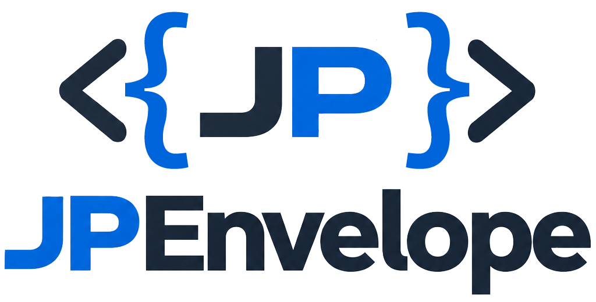

# JPEnvelope

JPEnvelope ist ein datengetriebenes, leichtgewichtiges Full-Stack-Framework für die nahtlose und asynchrone Zusammenarbeit zwischen PHP im Backend und modernem Vanilla JavaScript im Frontend.

Das Kernkonzept basiert auf dem Prinzip der namensgebenden Envelopes (Datenumschläge): Anstatt schwerfällige Frameworks oder relationale SQL-Datenbanken zu bemühen, verpackt JPEnvelope Geschäftslogik, Zustände und Validierungen in standardisierte JSON-Strukturen. Diese dienen als Single Source of Truth für Client und Server gleichermaßen.

<p float="left">
  
  
  
  
  
  
  
  
  
  
</p>

<p float="left">
  
  
</p>

---

## Kernmerkmale

* **Minimalistischer Core:** PHP & Vanilla JavaScript Architektur
* **Deklarative JSON-Architektur:** Views, Parameter-Whitelists, Benutzerrechte und Formularfelder werden zentral in JSON-Dateien gepflegt.
* **Asynchroner JS-Loader & Registry:** Im Client wird nur ein minimaler Core statisch geladen. Business-Klassen, Templates und Bibliotheken werden on demand asynchron nachgeladen.
* **Single Source Validierung:** Clientseitige Validierung und serverseitige Absicherung nutzen dieselben JSON-Felddefinitionen.
* **Robustes Fehlermanagement (weich & hart):** Abgelehnte Guards erscheinen als Fehlerkarten im zentralen Frontend-Overlay (weicher Kanal); unbehandelte Crashes fängt ein zweistufiges Try-Catch-Sicherheitsnetz im Backend mit einer generischen Fehlerseite statt einer weißen Seite ab (Härtekanal, Details nur im Log). Die JS-Seite meldet über einen eigenen `window.onerror`-Kanal in dasselbe Overlay.
* **Rollenbasierte Rechte & Auth:** Views und Actions werden deklarativ über JSON-Konfigurationen gegated, nach dem Login trägt ein AES-verschlüsselter Cookie-Token die Anmeldung.

---

## Architektur & Datenfluss

JPEnvelope basiert auf einem deklarativen, JSON-konfigurierten **Frontend Controller**. Geschäftslogik, Parameter-Validierung, Routing und Berechtigungen werden über JSON-Dateien konfiguriert.

Das Framework nutzt ein **Lazy-Loading-Prinzip**, um die initiale Ladezeit minimal zu halten.

JPEnvelope orchestriert den Start im Client über eine eventgetriebene Architektur. Dadurch wird sichergestellt, dass Klassen, Daten und externe Ressourcen (wie externe Bibliotheken)  in der richtigen Reihenfolge bereitstehen.

---

### Der Kollektor

Die Kommunikation zwischen Backend und Frontend erfolgt über ein standardisiertes Datenformat, den **Envelope** (Daten-Umschlag):

Jedes Business-Objekt, das für das Frontend bestimmt ist, wird in folgendes JSON-Format verpackt:

```json
{
  "class": "User",
  "id": "max@mustermann.de",
  "data": { ... }
}
```

- **`class`:** Der Klassenname (behält die Großschreibung bei).
- **`id`:** Der eindeutige Schlüssel für die clientseitige Registry.
- **`data`:** Die Nutzdaten. Sensible Daten (wie der Passwort-Hash des Users) werden hierbei  über die PHP-Konstante `NOSERIALIZE` herausgefiltert.

---

### Der Bootstrap (Loader)

Der Bootstrp im Client wird über ein Inline-Skript in der `header.start.tmpl` gestartet und läuft in folgenden Schritten ab:

```
[ Server-Daten injizieren ] ──► Schreibt rawObjects & config in den Namespace
            │
            ▼
[ Kern-Instanzen ] ───────────► `new Registry()` und `new Loader()` werden erstellt
            │
            ▼
[ loader.registerObjects() ] ─► Erstellt die Objekt-Instanzen via `createInstance`
            │
            ▼
[ Ressourcen laden ] ─────────► Via `await` auf alle `loadResources()` (z.B. CSS, Chart.js) warten
            │
            ▼
[ App Ready ] ────────────────► Registriert Objekte in der Registry & feuert `registry.setAppReady()`
```

Die Registrierung verarbeitet alle übergebenen Envelopes parallel:

```
[Envelope empfangen] ➔ createInstance() (Prüft Klasse, lädt JS-Datei ggf. via Promise-Dedupe nach)
                              ↓
                      [Instanziierung] ➔ data-Payload via fillObject() befüllen
                              ↓
                      [loadResources()] ➔ Externe Skripte/CSS via await nachladen
                              ↓
                      [Registry] ➔ Instanz registrieren ➔ registry.setAppReady() feuert
```

---

### Die Registry

Die clientseitige `Registry` fungiert als Speicher-Zentrale im Frontend und ist als zweistufige Map aufgebaut:

```
Registry ➔ [Klassenname (kleingeschrieben)] ➔ [Objekt-ID] ➔ [JS-Instanz]
```

- `get(klasse)`: Liefert die erste gefundene Instanz dieser Klasse.
- `getAll(klasse)`: Liefert eine Kopie der Map dieser Klasse.
   **Wichtig:** Blaupausen (mit der ID `Registry::BLUEPRINTID = 'new'`) werden hierbei herausgefiltert. Dadurch können Templates in Schleifen (Template-Loops) iterieren, ohne Prüfungen einbauen zu müssen.

Sobald eine Instanz registriert wird, feuert die Registry zwei Events ab:

1. `ready:{klasse}:{id}` (Spezifisch für diese eine Instanz)
2. `ready:{klasse}` (Global für alle Instanzen dieser Klasse)

Wenn das Event bereits gefeuert wurde, nutzt das Framework ein **Fired-Events-Replay**: Bereits verpasste Events werden für zu spät registrierte Listener wiederholt!

Die zwei `onReady`-Modi der Registry

|Modus|Aufruf-Syntax|Verhalten|Typischer Einsatzzweck|
|---|---|---|---|
|**Mit ID**|`onReady(klasse, id, callback)`|**Einmalige Zustellung.** Der Callback wird nach der Ausführung sofort gelöscht und nicht gespeichert.|Gezieltes Warten auf eine ganz bestimmte Instanz.|
|**Ohne ID**|`onReady(klasse, null, callback)`|**Dauer-Abonnement.** Der Callback bleibt permanent aktiv. Er feuert sofort für alle bereits existierenden Instanzen und für jede zukünftige Instanz.|Für dynamisch nachgeladene Objekte wie die **Blaupausen-Route**.|

---

### Neue Instanzen (Blueprints)

Wenn im Frontend ein Formular zum **Anlegen eines neuen Objekts** geöffnet wird, existiert im Backend noch keine Instanz (und somit kein Daten-Envelope). Hierfür nutzt das System sogenannte **Blaupausen (Blueprints)**.

Ablauf einer Blaupausen-Anforderung (Asynchron)

```
[Template] ➔ app.newObject('Klasse')
                  ↓
[JS-Loader] ➔ Fetcht: index.php?view=viewNewObject&newClass=Klasse
                  ↓
[PHP-Backend] ➔ Erzeugt leere Instanz per Reflection (am Konstruktor vorbei)
                  ↓
[Standard-Pipeline] ➔ createInstance ➔ Registrierung in JS-Registry unter ID 'new'
                  ↓
[Callback] ➔ registry.onReady('Klasse', 'new', (instanz) => { ... })
```

---

### Die View

Jede darstellbare Seite oder API-Endpunkt ist in `includes/json/data/views.json` registriert.

Aufbau eines Views in der `views.json`:

|Attribut|Typ|Beschreibung|
|---|---|---|
|`viewName`|_String_|Die auszuführende Methode auf der Zielklasse (`className`).|
|`resultType`|_String_|Ausgabe-Typ: Leer = HTML-Rendering. `"json"` = Sendet JSON-Header + `json_encode`.|
|`roleIds`|_Array_|Liste der Benutzerrollen, die diese View aufrufen dürfen.|
|`templateNames`|_Array_|Die für die View zu ladenden Templates.|
|`actionNames`|_Object-Array_|Registrierte Business-Logik-Aktionen, die **vor** dem Rendern laufen.|

---

### Das Action-Routing

Das Framework trennt Trigger-Namen im HTML-Formular von den PHP-Methodennamen. Das Routing (`View::executeActions`) mappt Requests anhand zweier Action-Typen:

- **`always` (true):** Diese Action läuft bei _jedem_ Aufruf dieser View unkonditioniert mit.
- **`trigger` (String):** Läuft nur, wenn der übergebene `action`-Parameter exakt mit dem Trigger-Wert (z. B. `changeUser`) übereinstimmt.

> ***Fail-Loud-Validierung gegen Config-Drift***
>
> Beim Ausführen (`View::validateActions` & `validatePermissions`) prüft das Framework, ob alle konfigurierten Klassen/Methoden existieren und das JSON-Format stimmt.
> Bei Fehlern wird eine `RuntimeException` ausgelöst.
> Es gibt **keine stillen Fehler (Zombies)** im Hintergrund, das System meldet Fehler über den Controller als geloggten Fehler.

---

### Die Parameter-Validierung (`Request` & `params.json`)

Die `Request`-Klasse kapselt den Zugriff auf globale PHP-Superglobals ab. **Es sollte im Framework nicht, direkt auf `$_GET` oder `$_POST` zugegriffen werden.**

Das System verfolgt ein **"Fail-Closed" / "Fail-Loud"-Prinzip**. Zugriff auf globale Variablen ist tabu.

- **Zentrale Instanz:** Die Klasse `Request` (`includes/classes/request.php`) ist die **einzige** Stelle im Framework, die `$_GET` und `$_POST` ausliest.
- **Datenabruf:** Klassen holen sich Werte über `Request::param('name')`.
- **Internes Verhalten:** `Request` nutzt einen internen Cache pro Parameter (GET überschreibt POST). Leere Strings oder Arrays werden als nicht vorhanden gewertet und liefern `null`.

---

### Die Ausnahmebehandlung

Das Framework unterscheidet zwischen **weichen Fehlern** (Validierungsfehler, abgewiesene Berechtigungen) und **harten Fehlern** (unbehandelte System-Exceptions).

**Der weiche Fehlerkanal (`AppError`):** Fehler, die während der Ausführung auftreten (z. B. eine fehlgeschlagene Aktion), werden zentral gesammelt und am Ende der Verarbeitung ausgegeben.

**Der harte Fehlerkanal ( `Exception`):** Um eine leere weiße Seite im Client zu verhindern, besitzt das Framework ein **zweistufiges, serverseitiges Fangnetz** gepaart mit einem **Client-Handler**.

|Stufe|Bereich|Was wird abgefangen?|Auswirkung im Ernstfall|
|---|---|---|---|
|**Stufe 1A**|`executeActions`|Absturz während einer Geschäftslogik-Aktion.|Die Exception wird als `addErrorFromThrowable` in einen weichen AppError umgewandelt. Das Rendering läuft mit **HTTP 200** weiter.|
|**Stufe 1B**|View-Zweig|Absturz während des eigentlichen View-Renderings.|Das System bricht ab und sendet **HTTP 500**. HTML-Views zeigen eine statische Not-HTML (`HARD_ERROR_HTML`), JSON-Views liefern einen leeren Body.|
|**Stufe 2**|`index.php`|Boot-Crashes (z. B. `params.json` unlesbar oder View-Zweig fehlt).|Das Notznetz greift im Root-Einstieg, bevor die App initialisiert ist.|

---

## Repository-Struktur

```text
├── index.php                 # Zentraler Einstiegspunkt (Front-Controller)
├── includes/
│   ├── classes/              # Core PHP-Klassen (BaseObject, Controller, Request, etc.)
│   ├── css/                  # Stylesheets (core.css, classes.css, style.css, etc.)
│   ├── docs/                 # Dokumentation und API Dokumentation (PHP & JS)
│   ├── images/               # Images, Icons, Brands, Assets
│   ├── js/                   # Vanilla JS App-Infrastruktur (loader.js, registry.js, etc.)
│   ├── json/
│   │   ├── data/             # Systemkonfigurationen (configs.json, views.json, params.json, roles.json)
│   │   └── fields/           # Formular- und Validierungsdefinitionen für Klassen
│   ├── templates/            # HTML5/PHP-Komponenten-Templates (.tmpl)
│   ├── tests/                # CLI-Regressionssuiten (bootstrap.php + 9 Suiten)
```

---

## Test-Suiten

| Aktion | Befehl |
| :--- | :--- |
| **PHP-Syntaxcheck** | `php -l includes/classes/measurement.php` |
| **JS-Syntaxcheck** | `node --check includes/js/baseObject.js` |
| **Test-Suiten ausführen** | `php includes/tests/collectorTest.php` |

*Hinweis zum Testen:* Die Test-Suiten nutzen ein eigenes Bootstrapping (`includes/tests/bootstrap.php`), welches fehlende Produktivdaten via `SKIP`-Pfade abfängt.

---

## Lizenz

**Dieses Projekt ist unter der MIT-Lizenz lizenziert.**
